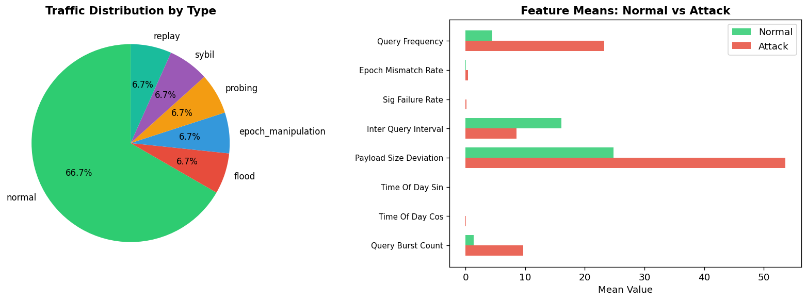
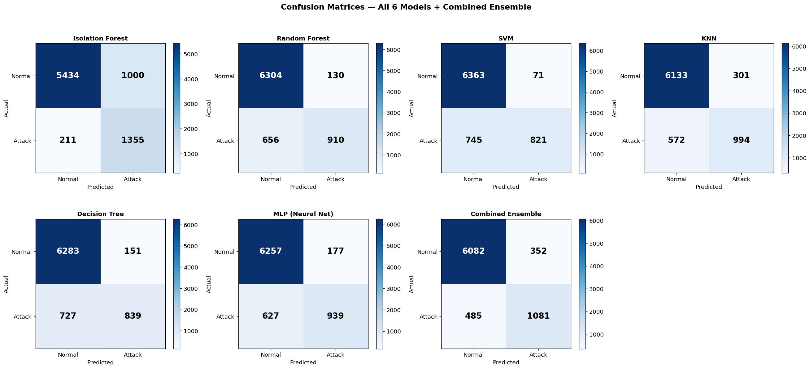
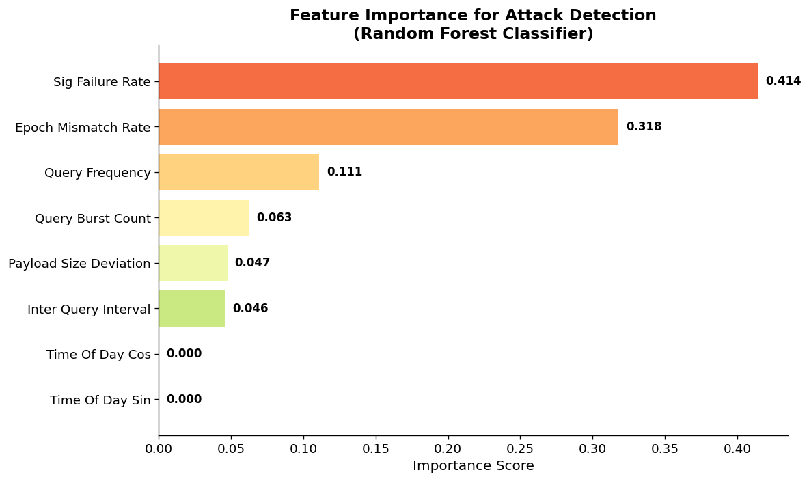
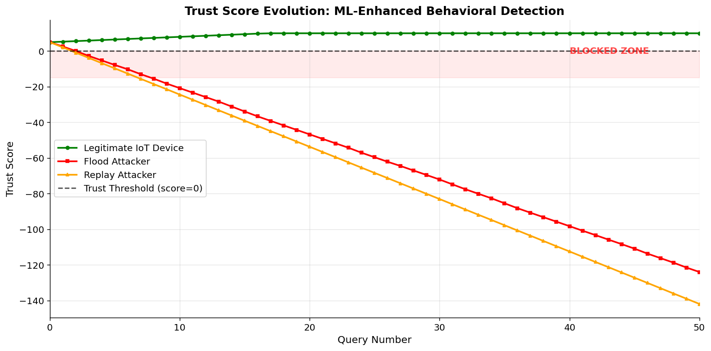
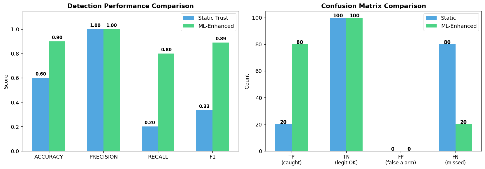
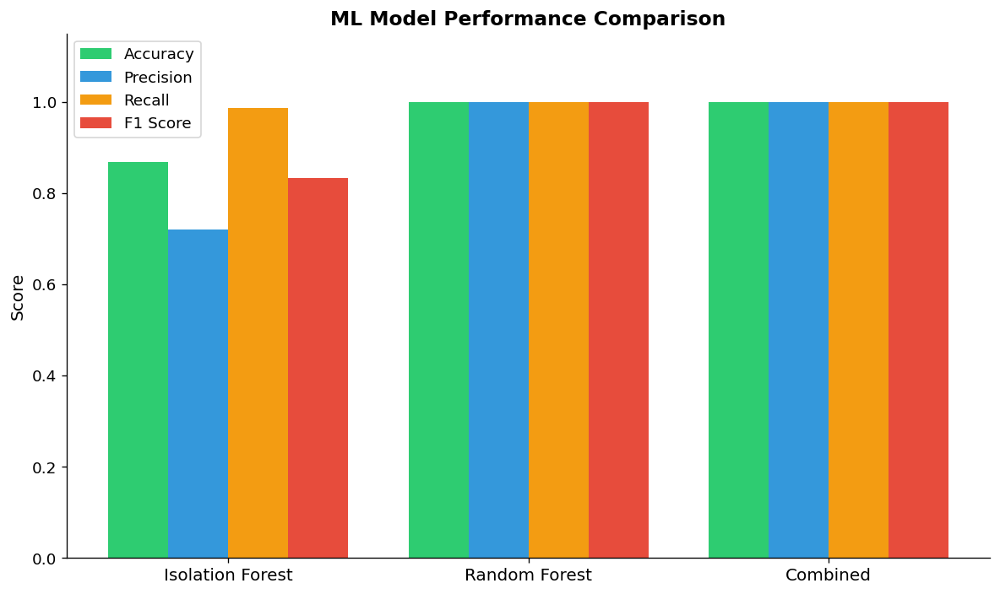

# ML-Trust Scoring Results (Updated Notebook)

This report follows the results displayed in `Major_Project_ML_Trust_Scoring_updated.ipynb`. The static-versus-ML benchmark evaluated 100 normal queries and 100 attack queries. These are the notebook's current run results; timings are environment-dependent.

## Static vs. ML-Enhanced Trust Scoring

| Metric | Static Trust | ML-Enhanced Trust |
|:---|---:|---:|
| Accuracy | 60.00% | 90.00% |
| Precision | 100.00% | 100.00% |
| Recall | 20.00% | 80.00% |
| F1-score | 33.33% | 88.89% |
| False positive rate | 0.00% | 0.00% |
| True positives (attacks caught) | 20 | 80 |
| False positives (false alarms) | 0 | 0 |
| True negatives (legitimate accepted) | 100 | 100 |
| False negatives (attacks missed) | 80 | 20 |

The ML-enhanced run caught 80 of 100 attacks, compared with 20 for static trust, while both methods accepted all 100 legitimate queries in this run. The notebook reports an average ML inference time of **119.56 ms**.

## Six-Model Training/Test Performance

The notebook reports the following metrics for the held-out test split of its 40,000-sample synthetic dataset (32,000 training samples, 8,000 test samples):

| Model | Accuracy | Precision | Recall | F1-score |
|:---|---:|---:|---:|---:|
| Isolation Forest | 88.08% | 61.05% | 99.93% | 75.80% |
| Random Forest | 95.89% | 88.25% | 89.97% | 89.10% |
| SVM | 95.43% | 86.30% | 89.77% | 88.00% |
| KNN | 95.13% | 86.91% | 87.02% | 86.97% |
| Decision Tree | 95.10% | 89.70% | 83.34% | 86.41% |
| MLP | 95.80% | 86.79% | 91.44% | 89.06% |
| Combined ensemble | 95.76% | 85.90% | 92.51% | 89.08% |

## Scenario Demonstrations

The notebook's illustrative feature vectors produced these decisions. Each row is one hand-specified scenario, so these outcomes are demonstrations rather than per-attack statistical recall estimates.

| Scenario | Anomaly detected | Confidence | Trust score | Decision |
|:---|:---:|---:|---:|:---|
| Normal IoT sensor | No | 0.8808 | 0.4464 | Allow |
| Flood attack | Yes | 0.9988 | 0.7631 | Block |
| Replay attack | Yes | 0.9552 | 0.6479 | Block |
| Epoch manipulation | Yes | 0.9873 | 0.6277 | Block |
| Sybil attack | Yes | 0.9962 | 0.7586 | Block |

## Evaluation scope

The static-versus-ML comparison and the six-model held-out test table are separate evaluations in the notebook; their sample sizes and results should not be conflated. Prior literature-comparison figures and cross-layer latency/CPU-saving claims are omitted here because they are not produced by this updated notebook run.

## Notebook Figures

Figures generated by the updated notebook:

*Figure: Synthetic traffic and label distribution.*

*Figure: Confusion matrices for the individual models and ensemble.*

*Figure: Random Forest feature importance.*

*Figure: Trust score trajectories across simulated behaviors.*

*Figure: Static versus ML-enhanced trust comparison.*

*Figure: Held-out performance across the six models and combined ensemble.*
