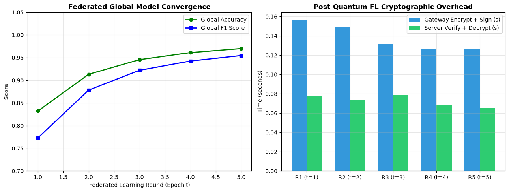
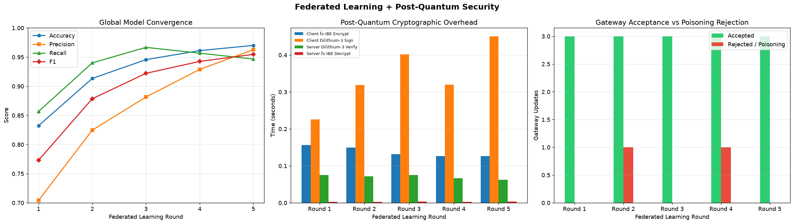

# Federated Learning Results (Updated Notebook)

Results below follow the telemetry displayed in `Major_Project_ML_Trust_Scoring_updated.ipynb`. The simulation ran five FedAvg rounds on the current 40,000-row dataset with three honest gateways and a malicious gateway that submitted tampered signatures in rounds 2 and 4. Timings are environment-dependent.

## Round-by-round global model metrics

| Round | Epoch | Accuracy | Precision | Recall | F1 | Honest gateways accepted | Malicious updates rejected |
|---:|---:|---:|---:|---:|---:|---:|---:|
| 1 | 1 | 0.8255 | 0.5725 | 0.2615 | 0.3590 | 3 | 0 |
| 2 | 2 | 0.8884 | 0.8558 | 0.4843 | 0.6185 | 3 | 1 |
| 3 | 3 | 0.9075 | 0.8896 | 0.5766 | 0.6997 | 3 | 0 |
| 4 | 4 | 0.9181 | 0.9078 | 0.6254 | 0.7406 | 3 | 1 |
| 5 | 5 | 0.9345 | 0.8631 | 0.7719 | 0.8150 | 3 | 0 |

Accuracy rose from **0.8255** in round 1 to **0.9345** in round 5, and F1 rose from **0.3590** to **0.8150**. Three honest gateway updates were accepted in every round; the tampered update was rejected in rounds 2 and 4.

## Post-quantum cryptographic timings

Times are seconds per round, as reported by the notebook.

| Round | Client fs-IBE encryption | Client ML-DSA-65 signing | Server ML-DSA-65 verification | Server fs-IBE decryption |
|---:|---:|---:|---:|---:|
| 1 | 0.2559 | 0.2633 | 0.1260 | 0.0047 |
| 2 | 0.2131 | 0.5217 | 0.1138 | 0.0040 |
| 3 | 0.2044 | 0.1990 | 0.1046 | 0.0041 |
| 4 | 0.2044 | 0.6659 | 0.1312 | 0.0036 |
| 5 | 0.2474 | 0.7315 | 0.1438 | 0.0052 |

## Security checks

- **Forward secrecy:** Verified. An epoch-1 ciphertext decrypted at epoch 1, the server advanced to epoch 6, and the old ciphertext returned `None` under the epoch-6 key bundle.
- **Signature tampering:** A valid gateway update verified successfully. A tampered payload and a modified signature both failed verification.
- **ML-DSA-65 sizes:** Public key 1,952 bytes; secret key 4,032 bytes; signature 3,309 bytes.

Source files: `FL_Results_Report.csv` contains the round telemetry, and `fl_simulation_results.json` contains the same metrics plus the security audit outcomes.

## Federated Learning Figures

Figures generated by the updated notebook:

*Figure: Federated global model convergence across rounds.*

*Figure: Federated metrics, cryptographic timings, and gateway acceptance/rejection.*
